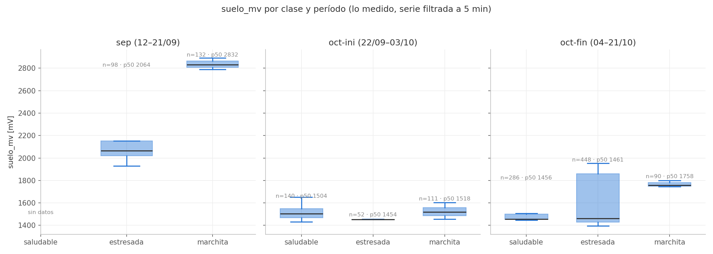
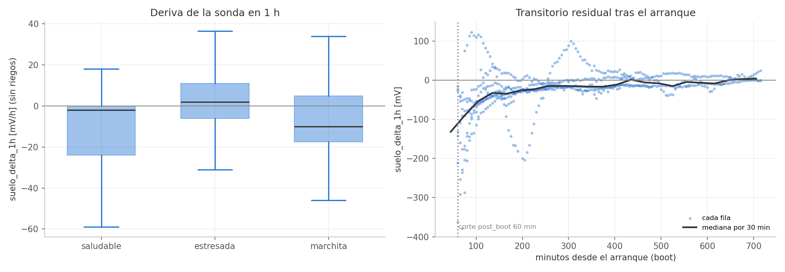
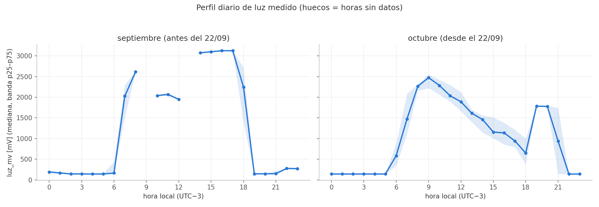
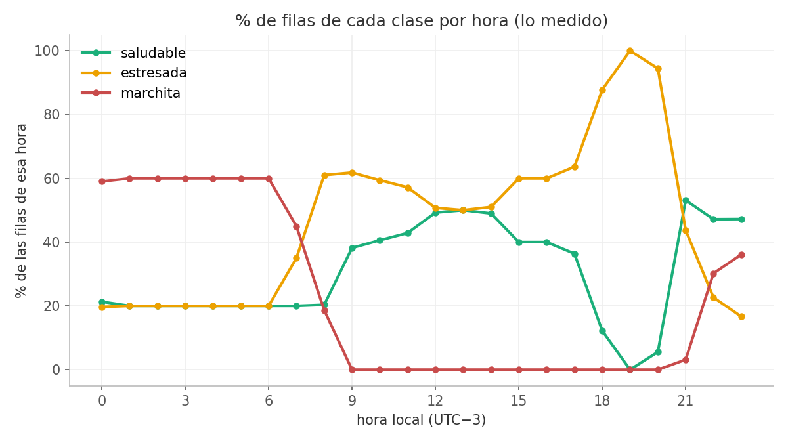

# Auditoría de datos — base de Railway y serie medida

Fecha: 2026-10-21 (descarga de la base a las 22:53 UTC). Auditoría de **datos**:
no se revisó el código del modelo. No se escribió nada en Railway (sólo `GET`)
ni se tocó el código del modelo. Los scripts y las descargas están en el
scratchpad de la sesión, no en el repo.

## Resumen ejecutivo

| Pregunta | Veredicto | Riesgo para el modelo |
|---|---|---|
| ¿La base de Railway tiene los datos bien cargados? | **Sí.** El snapshot `mediciones_raw_2026-10-21.csv` coincide fila por fila con la base: 14.791 filas idénticas en las 23 columnas. Hay 184 filas nuevas posteriores. Sin duplicados, sin otros dispositivos, `numero_muestra` monotónico. | Bajo |
| ¿La serie medida sirve tal cual para entrenar? | **Con cuidado.** La sonda deriva hacia abajo después de cada arranque, el filtro post-arranque se lleva episodios enteros, la clase está confundida con la hora de observación, y en octubre ninguna regla monótona en `suelo_mv` respeta a la vez la marchita y la estresada del 19/10. | **Medio-alto** para la validez sobre la planta real. |

Hallazgos por severidad (los IDs que faltan, H1, H3 y H5, no se usan):

| # | Severidad | Hallazgo |
|---|---|---|
| H2 | **Alta** | La única marchita de octubre con observación directa (ep. 12, 1758 mV) tiene el sustrato **más húmedo** que la estresada del mismo día (ep. 13, 1927 mV). Ninguna regla monótona en `suelo_mv` puede respetar las dos. |
| H4 | Media | `suelo_delta_1h` deriva hacia **abajo** (mediana −5 mV/h de noche): migración de iones y transitorio residual después del corte de 60 min. La sonda casi no «se seca» a la vista. |
| H6 | Media | La clase está confundida con la hora: la marchita medida es sólo nocturna (de 22 a 8 h, luz mediana 142 mV) y la saludable diurna (1427 mV). V de Cramér clase ~ franja de 3 h = 0,47. |
| H7 | Media | El filtro `post_boot` de 60 min elimina enteros los ep. 2, 4, 5 y 7. El 5 es el **único saludable de septiembre** y el 7 es una marchita manual. |
| H8 | Baja | Artefactos de remuestreo: la serie medida es la mediana de ~10 lecturas de 30 s por bin, así que el 28–31 % de `suelo_mv`/`luz_mv` tiene decimales (.5) y el ruido de 5 min es la mitad del que verá la placa con firmware 2.0.0 (una lectura cada 5 min). |
| H9 | Baja | Base: 88 filas del 12/09 con termistor saturado (`termistor_raw` 4095) traen `temp_ntc_c = −28,2` **sin** marca en `errores`. Rompe la convención «falla → null + errores», pero no afecta: el termistor no es feature. |
| H10 | Baja | La nota del ep. 8 en `episodios.csv` decía «~1900 mV» y la mediana real es **1526 mV**. Ya corregida (ver C). |

---

## A. Base de Railway

**Fuente:** `GET /api/v1/mediciones.csv` (200, 14.975 filas) y
`GET /api/v1/mediciones/ultima`. **`GET /api/v1/dataset.csv` devuelve 404**: el
endpoint que menciona CLAUDE.md no existe en el backend desplegado (en
`backend/app/routers/` no hay ningún router que lo defina). Las tablas de
observaciones/episodios de ARQUITECTURA.md tampoco tienen `GET` público. Por eso
las etiquetas se auditaron contra `data/episodios.csv` y la
`condicion_etiqueta` que manda la placa, no contra una tabla de anotaciones de
la base.

### A.1 Snapshot local vs. base

| Chequeo | Resultado |
|---|---|
| Filas | base 14.975 / snapshot 14.791 |
| Rango común (por `id`) | 14.791 filas, **0 diferencias** en las 22 columnas restantes |
| Filas sólo en el snapshot | 0 (no se borró nada de la base después del snapshot) |
| Filas nuevas | 184: `id` 20481–20664, `numero_muestra` 14791–14974, boot 49, 21/10 21:22 → 22:53 UTC, cadencia 30 s, suelo ~1497 mV, todas `saludable/propagada` |
| Dispositivos | **sólo `maceta-01`**. No hay datos de prueba en la base |
| Firmware | 1.1.0 en el 100 % de las filas (la placa no se reflasheó) |
| Huecos de `id` | uno solo: 6523 → 12213 (filas de otro dispositivo que se borraron, documentado en `data/README.md`). `numero_muestra` sigue correlativo |

Las 184 filas nuevas quedan **fuera de todo episodio**: el ep. 15 termina en
21:21:38. Si se baja otro snapshot, hay que extender el 15 o abrir uno nuevo.

### A.2 Integridad

- **Duplicados** por `(dispositivo, numero_muestra)`: 0. Por `id`: 0. Filas de
  contenido idéntico: 0.
- **`numero_muestra` por `boot_id`**: monotónico en los 24 boots, sin
  retrocesos. Hay un solo hueco: falta una muestra en el boot 16. En el orden
  global el único «retroceso» es el boot 1 (nm 1) seguido del boot 16 (nm 0),
  que reinició el contador.
- Los `boot_id` saltan (1, 16, 18, 20, …, 49): los arranques intermedios no
  llegaron a mandar nada. No es un error de la base.

### A.3 Tiempo

| Chequeo | Resultado |
|---|---|
| `ts_dispositivo` < 2026 | 1 fila (id 1, 2025-09-11), sin `hora_sin_sincronizar` en `errores` (firmware viejo) |
| `ts_dispositivo` nulo | 4 filas (ids 2, 60, 1546, 12213), todas con `hora_sin_sincronizar`. Correcto: null, no 0 |
| Futuro (> ahora) | 0 en `ts_dispositivo` y 0 en `ts_servidor` |
| Saltos atrás de `ts_dispositivo` (orden por `numero_muestra`) | 0 |
| Desfase servidor − placa | mediana 2,3 s, p99 6,2 s, máx. 79 s (2 filas > 60 s). Ninguno negativo: el NTP anda bien |
| Cadencia | **30 s en el 99,2 %** de los intervalos. 0 % a 5 min. Las nuevas, 30 s |

**Huecos > 2 min** (34 en total). Los grandes:

| desde → hasta (UTC) | h |
|---|---|
| 13/09 11:54 → 15/09 12:28 | 48,6 |
| 15/09 15:34 → 16/09 15:37 | 24,1 |
| 17/09 00:09 → 17/09 18:01 | 17,9 |
| 17/09 18:59 → 21/09 23:56 | 101,0 |
| 22/09 00:09 → 01/10 00:39 | 216,5 |
| 01/10 15:12 → 02/10 00:50 | 9,6 |
| 02/10 03:04 → 02/10 11:13 | 8,2 |
| 02/10 15:41 → 03/10 12:36 | 20,9 |
| 03/10 20:35 → 18/10 23:31 | 362,9 |

Los otros 25 son cortes de 2,5 a 9 min. Hay racimos el 12/09 a la noche, el
16/09 de 20:04 a 20:22 y el 19/10 de 05:29 a 05:44 y de 11:54 a 12:29 (WiFi).

### A.4 Rangos físicos, nulos y ceros

- **T** 8,1–35,6 °C, **HR** 18–77 %. Sin valores fuera de [0, 50] °C ni de
  [5, 95] %. Hay 547 filas ≥ 26 °C: son el radiador, documentado, no outliers.
- **DHT11**: 0 nulos y 0 errores en toda la base. Tampoco hay T = 0 ni HR = 0.
- **mV**: ninguno > 3124. **raw**: ninguno fuera de [0, 4095].
- **Suelo saturado** (raw 4095): 85 filas, todas con `suelo_saturado` en
  `errores` (0 inconsistencias en los dos sentidos). Casi todas son las
  primeras filas de un arranque: el boot 36 (16/09 15:37–16:05) es **entero**
  saturado, o sea todo el ep. 4. Hay 3 filas a mitad del boot 38. Ninguna con
  raw 0.
- **Luz raw 0**: 4.415 filas → 142 mV. Es **oscuridad real**, no una falla
  (marcadas `luz_saturada`, como dice `data/README.md`). No hay que pasarlas a
  null.
- **Termistor**: 88 filas (boots 16, 18 y 20, 12/09) con raw 4095 y
  `temp_ntc_c = −28,2` sin marca de error (H9).
- **`suelo_pct`**: null en 14.916 filas. Vale 100 en los boots 16 y 18 y 54 en
  el id 1: es un resto de una versión del firmware que lo calculaba. No se usa.
- **Ceros que deberían ser null**: no se encontró ninguno en sensores. Los
  únicos ceros son `luz_raw = 0`, que es oscuridad.

### A.5 Etiquetas vs. `data/episodios.csv`

- 15 episodios sin solapes. En cada uno, la `condicion_etiqueta` de la placa
  coincide al 100 % con la clase del episodio. La excepción es el ep. 1, que la
  placa mandó como `sin_etiquetar` y está corregido a mano, como dice su nota.
- **Pulsaciones `manual`**: 21. Las que anclan episodios son las de las
  muestras 1643, 1926, 2049, 2894, 3034, 4242, 4877, 6920/6922, 7795 y 12208.
  Las 9 del 21–22/09 son pruebas del botón y la del id 1 es del boot de 2025;
  ninguna tiene episodio, como está documentado.
- La mediana de suelo de cada episodio confirma lo que ya dicen las notas.
  Agrega dos casos:
  - El **ep. 9** (`estresada`, manual, 1454 mV) es tan inconsistente con su
    sustrato como el 8 y el 14 (ya está en `EPISODIOS_DUDOSOS`).
  - El **ep. 8** marca 1526 mV de mediana, no los «~1900» que decía su nota en
    `episodios.csv` (H10, ya corregida).

### A.6 Lo que quedó afuera por no tener acceso a Postgres

- Si el borrado de las filas del otro dispositivo (ids 6524–12212) dejó restos
  en otras tablas (observaciones, eventos, fotos) o secuencias.
- Si las tablas de anotaciones y predicciones de ARQUITECTURA.md existen y
  coinciden con `episodios.csv`. No hay `GET` y `dataset.csv` da 404.
- Constraints reales (`UNIQUE (dispositivo, numero_muestra)`, `EXCLUDE` de
  episodios) y el estado de `alembic_version`.
- Metadatos de `/api/v1/fotos`: requiere `PHOTO_READ_TOKEN`, no se usó.

---

## B. La serie medida a 5 min

Datos: la serie de `maceta-01` remuestreada a 5 min y filtrada
(`plantaia_ml.dataset`, con el corte `post_boot` de 60 min): **1.357 filas, 11
episodios** (1, 3, 6, 8–15). Las figuras de esta sección son sólo de esa serie.

**Correlaciones entre features.** T–HR −0,82, T–VPD 0,88, luz–luz_1h 0,95.
La que llama la atención es **suelo_mv–temp_c: −0,54**: el suelo seco de
septiembre coincide con el frío del 13/09 (ep. 1). Es una correlación espuria
de los pocos episodios que hay, no una relación física.

### B.1 La sonda: suelo por clase y período (H2)

Mediana de suelo por episodio (serie filtrada):

| ep. | clase | fecha | suelo |
|---|---|---|---|
| 1 | marchita | 13/09 | 2832 |
| 3 | estresada | 15/09 | 2767 (radiador) |
| 6 | estresada | 16/09 | 2048 |
| 8 | marchita (dudoso) | 01/10 | 1518 |
| 9 | estresada (dudoso) | 01/10 | 1454 |
| 10 | saludable | 03/10 | 1504 |
| 11 | saludable (dudoso) | 19/10 | 1786 |
| **12** | **marchita (manual)** | 19/10 | **1758** |
| 13 | estresada | 19/10 | 1927 |
| 14 | estresada (dudoso) | 20/10 | 1445 |
| 15 | saludable | 21/10 | 1453 |

**Septiembre es coherente**: marchita ~2800–2850 mV, estresada ~2050 (sin
contar el radiador). No hay ningún saludable de septiembre en la serie
filtrada: el único (ep. 5) lo elimina el corte post-arranque (H7).

**Octubre no lo es**:

- La marchita del 19/10 está en ~1750 mV y la estresada del mismo día en
  ~1930. **Ninguna regla monótona en `suelo_mv` puede respetar las dos.**
- El máximo de octubre en la serie filtrada es **1954 mV** (2228 sólo en el
  primer segundo del transitorio de arranque). Toda la escala de la sonda en
  octubre (recién regado ~1400 → más seco ~1950) mide unos 550 mV, contra
  ~1000–2850 de septiembre: es la corrosión de los electrodos que advierte
  CLAUDE.md, y por eso septiembre y octubre se pisan en `suelo_mv`.
- Los ep. 8, 9 y 14 tienen el sustrato en el rango de los saludable de
  octubre (1445–1518 mV): el problema ahí es la etiqueta, no la sonda.

**Decisión sobre el 19/10.** Las fotos de la ESP32-CAM no se pudieron mirar
(no hay `PHOTO_READ_TOKEN` local y `/api/v1/fotos` responde 401). Se le cree
al **ep. 12** (marchita manual, de noche, 1756 mV): las dos pulsaciones del
19/10 están a 40 mV (1756 y 1796), y la mediana de 1927 del ep. 13 sale de 11 h
propagadas sobre un sustrato más seco que la marchita observada. Se propone
marcar dudoso también el **13** (no se tocó `EPISODIOS_DUDOSOS`). La curva de
octubre se apoya en 6 días de datos y en 2 observaciones manuales en la zona
seca.

### B.2 Riego, deriva y transitorio (H4, H7)

**Riegos** (saltos de `suelo_mv` < −150 mV en 5 min): hay **uno solo** medido,
de **−418 mV** (19/10, fin del ep. 13).

**`suelo_delta_1h` sin riegos**:

| clase | p10 / p50 / p90 (mV/h) |
|---|---|
| saludable | −47 / −2 / +10 |
| estresada | −20 / +2 / +23 |
| marchita | −25 / −10 / +12 |

- De noche la mediana es −5 mV/h; de día, +0,5.
- **La sonda casi no «se seca» a la vista.** Lo que domina es la deriva
  hacia abajo: migración de iones y transitorio post-arranque.

**Transitorio después del corte de 60 min**: la mediana de `suelo_delta_1h`
vale

| Minutos desde el arranque | Mediana |
|---|---|
| 60–120 | −59 mV |
| 120–180 | −35 mV |
| 180–300 | −19 mV |
| > 600 | ~0 |

- **319 filas (24 %)** caen entre 60 y 300 min tras un arranque, con
  transitorio residual.
- Ese transitorio coincide con el arranque, y las etiquetas `propagada` de
  Preferences se concentran al arranque. Es un camino de leakage por episodio:
  un `suelo_delta_1h` fuertemente negativo dice «acaba de arrancar la placa»,
  no algo de la planta.
- **H7.** Ya con el corte de 60 min se pierden enteros los ep. 2, 4, 5 y 7: el
  5 es el único saludable de septiembre y el 7 una marchita manual. Un corte
  más largo eliminaría más transitorio, pero también más episodios.

### B.3 Luz, hora del día y observador (H6)

| hora local | septiembre | octubre |
|---|---|---|
| 8 | 2612 | 2263 |
| 10 | 2038 | 2285 |
| 14 | 3073 | 1460 |
| 16 | 3124 | 1137 |
| 21 | 150 | 938 |

(mediana de `luz_mv`, mV)

- Septiembre tiene sol de mañana **y** de tarde.
- En octubre la luz baja despacio a la tarde (~1000 mV a las 16–17 h) y la
  lámpara se apaga antes de las 21 h la mayoría de los días.

**Clase según la hora**: V de Cramér clase ~ franja de 3 h = **0,47**. La
marchita aparece **sólo de 22 a 8 h** (la observación nocturna). Con eso la
luz va al revés de lo que diría la botánica: luz mediana de la marchita
142 mV (oscuridad), de la saludable 1427 mV. Es el horario del observador, no
la planta: un modelo con `luz_mv`/`luz_media_1h` puede aprender «oscuro →
marchita», y eso no está respaldado por ninguna observación de marchitez
diurna.

### B.4 Ruido y cuantización (H8)

| | serie medida (mediana de 30 s por bin) |
|---|---|
| Δ5 min de `suelo_mv`, MAD | 1 mV (22 % de Δ = 0) |
| Δ5 min de `temp_c`, % sin cambio | 77 % |
| Δ5 min de `hum_aire_pct`, % sin cambio | 70 % |
| valores fuera de la grilla (decimales) | 28 % suelo, 31 % luz, 5 % HR, 2,5 % T |
| fallas del DHT | 0 en toda la base |

La placa con firmware 2.0.0 predice sobre **una** lectura cada 5 min (mediana
de 9 muestras ADC, pero sin la mediana de bin). El dato de entrenamiento es más
suave que lo que verá en producción; conviene revisar la sensibilidad del
modelo a un poco más de ruido en `suelo_mv` del que tiene la serie.

### B.5 Duración de episodios

| clase | n / mediana / máx. (h) |
|---|---|
| saludable | 4 / 12,4 / 42,8 |
| estresada | 6 / 9,8 / 25,1 |
| marchita | 5 / 7,5 / 13,1 |

Son duraciones de observación (de una pulsación a la siguiente), no la
duración verdadera de cada estado.

---

## C. Recomendaciones

### Para el modelado

1. **Ep. 9 en `EPISODIOS_DUDOSOS`**: estresada con 1454 mV, la misma
   inconsistencia que el 8 y el 14. *Aplicado.*
2. Decidir si el **ep. 13** también va como dudoso (B.1) y documentarlo.
3. Considerar `POST_BOOT_MIN` = 180 (o por lo menos 120). Pierde ~180 filas y
   elimina la mitad de la deriva de transitorio (B.2). Ojo: ya con 60 min se
   pierden enteros los ep. 5 y 7 (H7). Con un corte más largo, documentar qué
   episodios desaparecen.
4. Con un modelo que use `luz_*`, decir en el informe que la relación luz ↔
   clase viene del horario de observación (H6), no de la planta.
5. **Calibración semanal de la sonda** (CLAUDE.md, `docs/CALIBRACION.md`):
   sin ella, septiembre y octubre no se pueden comparar en `suelo_mv` (B.1).

### Para la base y la documentación

6. Nota del ep. 8 en `data/episodios.csv`: ~1526 mV, no ~1900. *Aplicado*
   (también se amplió la del 9 explicando su sustrato).
7. CLAUDE.md menciona `GET /api/v1/dataset.csv`, que da 404 en producción.
   Implementarlo o sacar la mención.
8. Firmware: con el termistor saturado (raw 0/4095), mandar `temp_ntc_c` en
   null y sumar `termistor_saturado` a `errores` (convención de CLAUDE.md).
9. Las 184 filas nuevas (21/10 21:22 → 22:53) no tienen episodio. Si se usan,
   extender el ep. 15.

---

### Reproducibilidad

Scripts y salidas en el scratchpad de la sesión de auditoría (fuera del
repo). Corren con `/opt/anaconda3/bin/python`.

| Script | Qué hace |
|---|---|
| `scripts/a_base.py`, `scripts/a2.py` | Parte A: descarga de la base y chequeos |
| `scripts/b*.py` | Parte B: chequeos sobre la serie medida |
| `figs_real.py` | Figuras de `docs/entrega2/fig/auditoria_*.png` |

La descarga de la base está en `descargas/mediciones.csv`.
