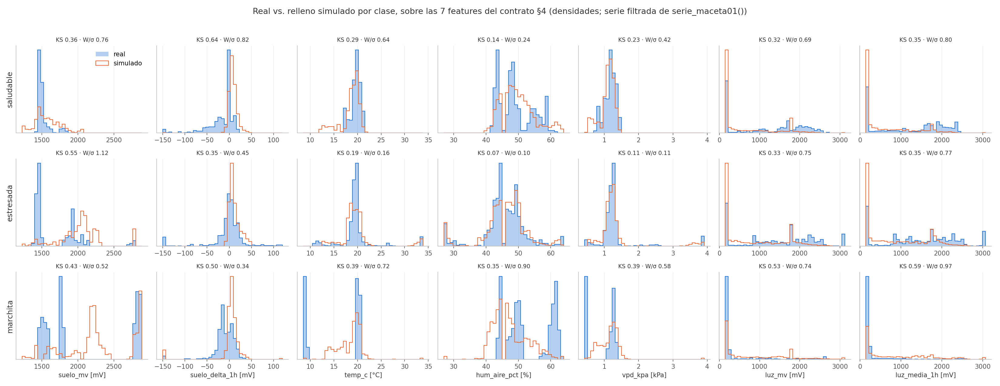
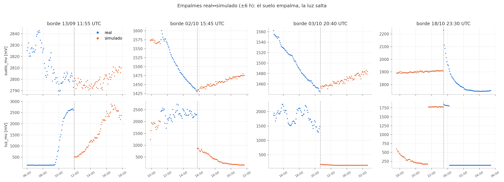
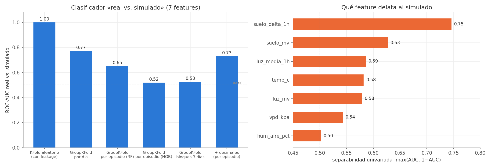
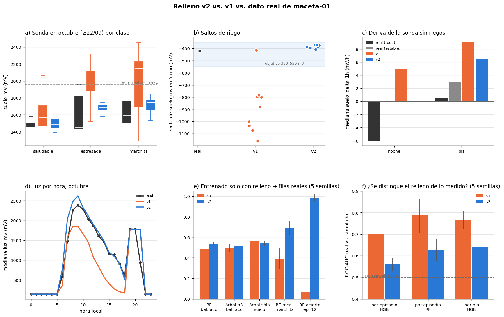

# Auditoría de datos — base de Railway y relleno simulado

Fecha: 2026-10-21 (descarga de la base a las 22:53 UTC). Auditoría de **datos**:
no se revisó el código del modelo. No se escribió nada en Railway (sólo `GET`),
no se tocaron `data/`, `simulador.py`, `relleno.py` ni el código del modelo. Los
scripts y las descargas están en el scratchpad de la sesión, no en el repo.

## Resumen ejecutivo

| Pregunta | Veredicto | Riesgo para el modelo |
|---|---|---|
| ¿La base de Railway tiene los datos bien cargados? | **Sí.** El snapshot `mediciones_raw_2026-10-21.csv` coincide fila por fila con la base: 14.791 filas idénticas en las 23 columnas. Hay 184 filas nuevas posteriores. Sin duplicados, sin otros dispositivos, sin datos simulados, `numero_muestra` monotónico. | Bajo |
| ¿El relleno simulado se parece al dato real? | **En el ambiente, sí; en la relación sonda → clase de octubre, no.** Un clasificador «real vs. simulado» no los separa de forma consistente (AUC 0,52–0,77 según cómo se agrupe). Pero el simulador pone `marchita` en octubre en lecturas de suelo que la sonda real **nunca** dio en octubre, y la única marchita real de octubre cae en zona «saludable» según su curva. | **Alto** para la validez sobre la planta real. Bajo para la tubería. |

**Recomendación:** no hace falta regenerar el relleno para cerrar la
*tubería* (features → modelo → C → placa) y la comparación de modelos. Lo que
el modelo aprende sobre octubre es la regla del simulador, no la de la sonda
real. Si se quiere un modelo que en la placa avise `marchita` con la sonda de
hoy, **hay que regenerar el relleno** con la curva de octubre recalibrada (H1
y H2). Mientras tanto, el informe tiene que reportar la métrica sobre
`fuente == 'real'` y decir esto explícitamente.

Hallazgos por severidad:

| # | Severidad | Hallazgo |
|---|---|---|
| H1 | **Alta** | En octubre la curva θ→mV del simulador pone el umbral de marchita en ~2030–2140 mV. El máximo real de octubre (serie filtrada) es **1954 mV**. El **31 %** de las filas simuladas de octubre (2.322 de 7.393) y el **65 %** de la marchita simulada de octubre están por encima de cualquier lectura real del mes. |
| H2 | **Alta** | La única marchita real de octubre con observación directa (ep. 12, 1758 mV) cae en θ = 0,43 según la curva del simulador, o sea `saludable`. Un modelo entrenado sólo con el simulado acierta **0 %** de sus filas, y lo mismo con el ep. 8 (marchita), el ep. 9 (estresada) y el ep. 14 (estresada). |
| H3 | Media | Los saltos de riego simulados son de −785 a −1159 mV en 5 min (9 riegos). El único riego real medido es de **−418 mV**. |
| H4 | Media | `suelo_delta_1h`: lo real deriva hacia **abajo** (mediana −5 mV/h de noche, transitorio residual después del corte de 60 min) y lo simulado sube siempre (+5 mV/h de noche, +12 de día). Es la feature que más delata al simulado (AUC univariada 0,75). |
| H5 | Media | Perfil de luz: las mañanas de septiembre simuladas están oscuras (240–770 mV de 7 a 10 h, contra 2000–2600 reales). Las tardes de octubre simuladas también están oscuras (200–830 mV de 13 a 18 h, contra 940–1600 reales). Hay saltos de −1300 a −2100 mV en los empalmes real→sim. |
| H6 | Media | La relación hora/luz ↔ clase es inversa: la marchita simulada es diurna (luz mediana 616 mV) y la real es nocturna (142 mV). |
| H7 | Media | El filtro `post_boot` de 60 min elimina enteros los ep. 2, 4, 5 y 7. El 5 es el **único saludable real de septiembre** y el 7 es una marchita manual. |
| H8 | Baja | Artefactos de remuestreo: lo real tiene la mediana de ~10 lecturas por bin, así que el 28–31 % de `suelo_mv`/`luz_mv` tiene decimales (.5) y el ruido de 5 min es la mitad. Lo simulado es una lectura entera por bin. |
| H9 | Baja | Base: 88 filas del 12/09 con termistor saturado (`termistor_raw` 4095) traen `temp_ntc_c = −28,2` **sin** marca en `errores`. Rompe la convención «falla → null + errores», pero no afecta: el termistor no es feature. |
| H10 | Baja | Desactualizados: la nota del ep. 8 en `episodios.csv` dice «~1900 mV» y la mediana real es **1526 mV**. Las cifras de `data/sintetico/README.md` también: dice 11.106 filas, 1.413 reales y 73 episodios, y hoy salen 11.043, 1.357 y 70. |

---

## A. Base de Railway

**Fuente:** `GET /api/v1/mediciones.csv` (200, 14.975 filas) y
`GET /api/v1/mediciones/ultima`. **`GET /api/v1/dataset.csv` devuelve 404**: el
endpoint que menciona CLAUDE.md no existe en el backend desplegado (en
`backend/app/routers/` no hay ningún router que lo defina). Las tablas de
observaciones/episodios de ARQUITECTURA.md tampoco tienen `GET` público. Por eso
las etiquetas se auditaron contra `data/episodios.csv` y la
`condicion_etiqueta` que manda la placa, no contra una tabla de anotaciones de
la base.

### A.1 Snapshot local vs. base

| Chequeo | Resultado |
|---|---|
| Filas | base 14.975 / snapshot 14.791 |
| Rango común (por `id`) | 14.791 filas, **0 diferencias** en las 22 columnas restantes |
| Filas sólo en el snapshot | 0 (no se borró nada de la base después del snapshot) |
| Filas nuevas | 184: `id` 20481–20664, `numero_muestra` 14791–14974, boot 49, 21/10 21:22 → 22:53 UTC, cadencia 30 s, suelo ~1497 mV, todas `saludable/propagada` |
| Dispositivos | **sólo `maceta-01`**. No hay `sim-*` ni datos de prueba en la base |
| Firmware | 1.1.0 en el 100 % de las filas (la placa no se reflasheó) |
| Huecos de `id` | uno solo: 6523 → 12213 (filas de otro dispositivo que se borraron, documentado en `data/README.md`). `numero_muestra` sigue correlativo |

Las 184 filas nuevas quedan **fuera de todo episodio**: el ep. 15 termina en
21:21:38. Si se baja otro snapshot, hay que extender el 15 o abrir uno nuevo.

### A.2 Integridad

- **Duplicados** por `(dispositivo, numero_muestra)`: 0. Por `id`: 0. Filas de
  contenido idéntico: 0.
- **`numero_muestra` por `boot_id`**: monotónico en los 24 boots, sin
  retrocesos. Hay un solo hueco: falta una muestra en el boot 16. En el orden
  global el único «retroceso» es el boot 1 (nm 1) seguido del boot 16 (nm 0),
  que reinició el contador.
- Los `boot_id` saltan (1, 16, 18, 20, …, 49): los arranques intermedios no
  llegaron a mandar nada. No es un error de la base.

### A.3 Tiempo

| Chequeo | Resultado |
|---|---|
| `ts_dispositivo` < 2026 | 1 fila (id 1, 2025-09-11), sin `hora_sin_sincronizar` en `errores` (firmware viejo) |
| `ts_dispositivo` nulo | 4 filas (ids 2, 60, 1546, 12213), todas con `hora_sin_sincronizar`. Correcto: null, no 0 |
| Futuro (> ahora) | 0 en `ts_dispositivo` y 0 en `ts_servidor` |
| Saltos atrás de `ts_dispositivo` (orden por `numero_muestra`) | 0 |
| Desfase servidor − placa | mediana 2,3 s, p99 6,2 s, máx. 79 s (2 filas > 60 s). Ninguno negativo: el NTP anda bien |
| Cadencia | **30 s en el 99,2 %** de los intervalos. 0 % a 5 min. Las nuevas, 30 s |

**Huecos > 2 min** (34 en total). Los grandes son los mismos que rellena el
simulador:

| desde → hasta (UTC) | h |
|---|---|
| 13/09 11:54 → 15/09 12:28 | 48,6 |
| 15/09 15:34 → 16/09 15:37 | 24,1 |
| 17/09 00:09 → 17/09 18:01 | 17,9 |
| 17/09 18:59 → 21/09 23:56 | 101,0 |
| 22/09 00:09 → 01/10 00:39 | 216,5 |
| 01/10 15:12 → 02/10 00:50 | 9,6 |
| 02/10 03:04 → 02/10 11:13 | 8,2 |
| 02/10 15:41 → 03/10 12:36 | 20,9 |
| 03/10 20:35 → 18/10 23:31 | 362,9 |

Los otros 25 son cortes de 2,5 a 9 min. Hay racimos el 12/09 a la noche, el
16/09 de 20:04 a 20:22 y el 19/10 de 05:29 a 05:44 y de 11:54 a 12:29 (WiFi).

### A.4 Rangos físicos, nulos y ceros

- **T** 8,1–35,6 °C, **HR** 18–77 %. Sin valores fuera de [0, 50] °C ni de
  [5, 95] %. Hay 547 filas ≥ 26 °C: son el radiador, documentado, no outliers.
- **DHT11**: 0 nulos y 0 errores en toda la base. Tampoco hay T = 0 ni HR = 0.
- **mV**: ninguno > 3124. **raw**: ninguno fuera de [0, 4095].
- **Suelo saturado** (raw 4095): 85 filas, todas con `suelo_saturado` en
  `errores` (0 inconsistencias en los dos sentidos). Casi todas son las
  primeras filas de un arranque: el boot 36 (16/09 15:37–16:05) es **entero**
  saturado, o sea todo el ep. 4. Hay 3 filas a mitad del boot 38. Ninguna con
  raw 0.
- **Luz raw 0**: 4.415 filas → 142 mV. Es **oscuridad real**, no una falla
  (marcadas `luz_saturada`, como dice `data/README.md`). No hay que pasarlas a
  null.
- **Termistor**: 88 filas (boots 16, 18 y 20, 12/09) con raw 4095 y
  `temp_ntc_c = −28,2` sin marca de error (H9).
- **`suelo_pct`**: null en 14.916 filas. Vale 100 en los boots 16 y 18 y 54 en
  el id 1: es un resto de una versión del firmware que lo calculaba. No se usa.
- **Ceros que deberían ser null**: no se encontró ninguno en sensores. Los
  únicos ceros son `luz_raw = 0`, que es oscuridad.

### A.5 Etiquetas vs. `data/episodios.csv`

- 15 episodios sin solapes. En cada uno, la `condicion_etiqueta` de la placa
  coincide al 100 % con la clase del episodio. La excepción es el ep. 1, que la
  placa mandó como `sin_etiquetar` y está corregido a mano, como dice su nota.
- **Pulsaciones `manual`**: 21. Las que anclan episodios son las de las
  muestras 1643, 1926, 2049, 2894, 3034, 4242, 4877, 6920/6922, 7795 y 12208.
  Las 9 del 21–22/09 son pruebas del botón y la del id 1 es del boot de 2025;
  ninguna tiene episodio, como está documentado.
- La mediana de suelo de cada episodio confirma lo que ya dicen las notas.
  Agrega dos casos:
  - El **ep. 9** (`estresada`, manual, 1454 mV) es tan inconsistente con su
    sustrato como el 8 y el 14, pero **no está** en `EPISODIOS_DUDOSOS`.
  - El **ep. 8** marca 1526 mV de mediana, no los «~1900» que dice su nota en
    `episodios.csv`. `EPISODIOS_DUDOSOS` lo tiene bien (~1550).

### A.6 Lo que quedó afuera por no tener acceso a Postgres

- Si el borrado de las filas del otro dispositivo (ids 6524–12212) dejó restos
  en otras tablas (observaciones, eventos, fotos) o secuencias.
- Si las tablas de anotaciones y predicciones de ARQUITECTURA.md existen y
  coinciden con `episodios.csv`. No hay `GET` y `dataset.csv` da 404.
- Constraints reales (`UNIQUE (dispositivo, numero_muestra)`, `EXCLUDE` de
  episodios) y el estado de `alembic_version`.
- Metadatos de `/api/v1/fotos`: requiere `PHOTO_READ_TOKEN`, no se usó.

---

## B. Relleno simulado vs. datos reales

Datos: `plantaia_ml.dataset.serie_maceta01()` (serie filtrada, 11.043 filas a
5 min) con la marca `fuente`.

- Real: 1.357 filas, 11 episodios (1, 3, 6, 8–15).
- Simulado: 9.686 filas.

Las comparaciones son sobre las 7 features del contrato §4.

### B.1 Distribuciones por clase

KS y Wasserstein normalizada por el desvío conjunto (W/σ). Valores < 0,2 son
parecidos y > 0,6 son claramente distintos.

| clase | feature | media real | media sim | p50 real | p50 sim | KS | W/σ |
|---|---|---|---|---|---|---|---|
| global | suelo_mv | 1731 | 1856 | 1504 | 1749 | 0,30 | 0,39 |
| global | suelo_delta_1h | −12,4 | −0,8 | −1 | 7 | 0,46 | 0,30 |
| global | temp_c | 18,7 | 18,8 | 19,8 | 19,2 | 0,22 | 0,28 |
| global | hum_aire_pct | 48,5 | 48,2 | 48 | 48 | 0,08 | 0,15 |
| global | vpd_kpa | 1,18 | 1,16 | 1,21 | 1,16 | 0,15 | 0,15 |
| global | luz_mv | 1112 | 756 | 1039 | 299 | 0,19 | 0,42 |
| saludable | suelo_mv | 1505 | 1572 | 1480 | 1541 | 0,36 | 0,76 |
| saludable | suelo_delta_1h | −17,5 | 7,4 | −2 | 7 | **0,64** | 0,82 |
| saludable | luz_media_1h | 1221 | 628 | 1508 | 222 | 0,35 | 0,80 |
| estresada | suelo_mv | 1682 | 2035 | 1465 | 2054 | **0,55** | **1,12** |
| estresada | temp_c | 19,7 | 19,8 | 19,5 | 19,3 | 0,19 | 0,16 |
| estresada | hum_aire_pct | 45,7 | 45,9 | 46 | 46 | 0,07 | 0,10 |
| marchita | suelo_mv | 2109 | 2270 | 1764 | 2219 | 0,43 | 0,52 |
| marchita | temp_c | 15,7 | 18,3 | 20,2 | 19,2 | 0,39 | 0,72 |
| marchita | hum_aire_pct | 53,1 | 47,4 | 50 | 46 | 0,35 | 0,90 |
| marchita | luz_media_1h | 305 | 933 | 143 | 702 | **0,59** | **0,97** |

La tabla completa (4 × 7 con p05/p95) está en el scratchpad
(`tabla_stats.csv`).

- **El ambiente está bien calibrado** (T, HR, VPD, sobre todo en estresada).
- **Lo que difiere es la sonda y la luz.** Parte de la diferencia por clase
  viene del lado real: 11 episodios, con la marchita dominada por la noche fría
  del ep. 1 (8–10 °C) y la noche del ep. 12. No todo es culpa del simulador.

**Correlaciones entre features.** T–HR −0,82 real / −0,81 sim, T–VPD 0,88 /
0,93, luz–luz_1h 0,95 / 0,93: se conservan. La mayor diferencia es
**suelo_mv–temp_c: −0,54 real contra −0,05 sim**. En lo real, el suelo seco de
septiembre coincide con el frío del 13/09. Es una correlación espuria del dato
real, y que el simulador no la copie está bien.

### B.2 La sonda: umbrales por clase y deriva entre meses (H1, H2)

Umbrales implícitos del simulador: curva `mojado + (seco − mojado)·(1−θ)^1,5`
con θ_m = 0,18 y θ_e = 0,35.

| fecha | marchita si suelo > | estresada si suelo > | riego (θ = 0,92) |
|---|---|---|---|
| 13/09 | 2502 mV | 2066 mV | 1066 mV |
| 01/10 | 2143 | 1924 | 1423 |
| 19/10 | 2038 | 1845 | 1402 |
| 21/10 | 2026 | 1836 | 1400 |

Contra lo medido (mediana de suelo por episodio real, en la serie filtrada):

| ep. | clase real | fecha | suelo | θ según la curva del sim. | clase que daría el sim. |
|---|---|---|---|---|---|
| 1 | marchita | 13/09 | 2832 | 0,06 | marchita ✔ |
| 3 | estresada | 15/09 | 2767 | 0,06 | marchita ✘ (radiador) |
| 6 | estresada | 16/09 | 2048 | 0,34 | estresada ✔ |
| 8 | marchita (dudoso) | 01/10 | 1518 | 0,76 | saludable ✘ |
| 9 | estresada | 01/10 | 1454 | 0,86 | saludable ✘ |
| 10 | saludable | 03/10 | 1504 | 0,77 | saludable ✔ |
| 11 | saludable (dudoso) | 19/10 | 1786 | 0,41 | saludable ✔ |
| **12** | **marchita (manual)** | 19/10 | **1758** | **0,43** | **saludable ✘** |
| 13 | estresada | 19/10 | 1927 | 0,27 | estresada ✔ |
| 14 | estresada (dudoso) | 20/10 | 1445 | 0,82 | saludable ✘ |
| 15 | saludable | 21/10 | 1453 | 0,81 | saludable ✔ |

**Septiembre es coherente**: marchita real ~2800–2850 contra el umbral sim.
2500, y estresada ~2050 contra el umbral 2066.

**Octubre no lo es**:

- La marchita real del 19/10 está en ~1750 mV y la estresada del mismo día en
  ~1930. **Ninguna regla monótona en `suelo_mv` puede respetar las dos.** El
  simulador eligió la segunda: su curva cierra el hueco 03→18/10 en 1910 mV =
  estresada.
- Con eso, el relleno pone la marchita de octubre en **1990–2290 mV**
  (mediana; p95 hasta 2434). Es una zona que la sonda real no visitó nunca en
  octubre: máximo 1954 mV en la serie filtrada, y 2228 sólo en el primer
  segundo del transitorio de arranque.

| Simulado de octubre | Filas | Por encima de 1954 mV (máx. real) |
|---|---|---|
| total | 7.393 | 2.322 (31 %) |
| estresada | — | 1.364 filas |
| marchita | — | 870 filas (65 % de la marchita) |
| saludable | — | 88 filas |

**Consecuencia medida.** Un modelo entrenado **sólo con el relleno** y evaluado
en las filas reales:

| Modelo | Exactitud balanceada | Recall de marchita real |
|---|---|---|
| RF de 30 árboles, prof. 8 | 0,41 | 0,33 |
| Árbol de prof. 3 | 0,47 | 0,41 |
| Árbol de prof. 3 sólo con `suelo_mv` | 0,56 | 0,40 |

- El recall de marchita viene **entero del ep. 1** (septiembre). En el ep. 12
  aciertan **0 %**.
- En la placa, con la sonda de hoy (~1450–1950 mV), el modelo **casi nunca
  diría `marchita` por suelo**. Si lo dice, será por la luz o la hora (B.4),
  no por el sustrato.
- Los ep. 8, 9 y 14 también dan 0 %, pero ahí el problema es la etiqueta real
  (dudosa), no el simulador.

En el otro sentido, el simulado de **septiembre** tiene `saludable` hasta 1190
mV y riegos que llevan la sonda a ~1066 mV. Lo más bajo real de septiembre son
1004 mV, en las filas post-arranque del 12/09: es plausible.

### B.3 Riegos, deriva y transitorio (H3, H4)

**Riegos** (saltos de `suelo_mv` < −150 mV en 5 min):

| Fuente | Cantidad | Tamaño |
|---|---|---|
| Real | 1 | −418 mV (19/10) |
| Simulado | 9 | −785, −799, −801, −880, −1003, −1035, −1075, −1159, −415 mV |

Vienen de que el riego lleva θ de ~0,1 a 0,92 sobre una escala de sonda de
900–2050 mV. Con la escala real de octubre (1400 → 1950, 550 mV en total) un
riego no puede mover más de ~550 mV.

**`suelo_delta_1h` sin riegos**:

| clase | p10 / p50 / p90 real | p10 / p50 / p90 sim. |
|---|---|---|
| saludable | −47 / −2 / +10 | −1 / +7 / +19 |
| estresada | −20 / +2 / +23 | 0 / +8 / +30 |
| marchita | −25 / −10 / +12 | −2 / +6 / +20 |

- De noche: −5 mV/h real contra +5 sim. De día: +0,5 real contra +12 sim.
- **La sonda real casi no «se seca» a la vista.** Lo que domina es la deriva
  hacia abajo: migración de iones y transitorio post-arranque.

**Transitorio después del corte de 60 min**: la mediana real de
`suelo_delta_1h` vale

| Minutos desde el arranque | Mediana real |
|---|---|
| 60–120 | −59 mV |
| 120–180 | −35 mV |
| 180–300 | −19 mV |
| > 600 | ~0 |

- **319 filas reales (24 %)** caen entre 60 y 300 min tras un arranque, con
  transitorio residual.
- El relleno no tiene arranques (por diseño), así que un `suelo_delta_1h`
  fuertemente negativo es una huella de «real».
- Además, en real ese transitorio coincide con el arranque, y las etiquetas
  `propagada` de Preferences se concentran al arranque. Es un camino de
  leakage por episodio.

### B.4 Luz, hora del día y empalmes (H5, H6)

| hora local | sept. real | sept. sim. | oct. real | oct. sim. |
|---|---|---|---|---|
| 8 | 2612 | 356 | 2263 | 1846 |
| 10 | 2038 | 770 | 2285 | 1666 |
| 14 | 3073 | 2288 | 1460 | 580 |
| 16 | 3124 | 2227 | 1137 | 273 |
| 21 | 150 | 151 | 938 | 1769 |

(mediana de `luz_mv`, mV)

- Septiembre real tiene sol de mañana **y** de tarde; el simulado sólo una
  campana centrada a las 15 h.
- En octubre real la luz baja despacio a la tarde (~1000 mV a las 16–17 h). El
  simulado cae a ~200–400 mV.
- La lámpara real se apaga antes de las 21 h la mayoría de los días; la
  simulada sigue hasta las 21–23 h.

**Clase según la hora**:

| Fuente | V de Cramér clase ~ franja de 3 h | Cuándo es marchita |
|---|---|---|
| Real | 0,47 | sólo de 22 a 8 h (la observación nocturna) |
| Simulado | 0,20 | sobre todo de 10 a 20 h (marchitez transitoria) |

- El simulador quita bien la confusión con la hora, pero introduce la
  contraria: en el relleno, la **luz alta va con marchita/estresada** (luz
  mediana marchita 616 mV y saludable 179 mV). En lo real es al revés
  (marchita 142 mV, saludable 1427 mV).
- La transitoria de mediodía es botánicamente razonable. Pero como el 87 % del
  entrenamiento es simulado, el modelo va a usar `luz_mv`/`luz_media_1h` como
  indicador de estrés, y eso **no está respaldado por ninguna observación
  real**.

**Empalmes.**

- **Suelo, real → sim.** Empalma bien en nivel: |salto| mediano 4 mV en los 15
  bordes dentro de un mismo tramo, máximo 77 mV (22/09 00:10). La **pendiente
  se invierte**: real bajando ~25 mV/h → sim subiendo.
- **Suelo, sim → real.** Siempre coincide con un arranque. Hay saltos de +75 a
  +381 mV que son el transitorio real: el bin cae en `post_boot` y la ventana
  se reinicia por el cambio de `boot_id`, así que no contaminan las features.
- **Luz.** Hay saltos grandes en real → sim:

  | Borde (UTC) | Salto de luz |
  |---|---|
  | 13/09 11:55 | −2099 mV (8:55 local: sol real, «amanecer» simulado) |
  | 02/10 15:45 | −1434 mV |
  | 03/10 20:40 | −1322 mV |
  | 01/10 15:15 | −757 mV |

  `luz_media_1h` arrastra el salto durante la hora siguiente. Son pocas filas
  (≤ 12 por borde) y el efecto en el modelo es menor. El problema de fondo es
  el perfil diario (arriba).

### B.5 Ruido, cuantización y DHT11 (H8)

| | real (mediana de 30 s por bin) | simulado (1 lectura/bin) |
|---|---|---|
| Δ5 min de `suelo_mv`, MAD | 1 mV (22 % de Δ = 0) | 3 mV (9 % de Δ = 0) |
| Δ5 min de `temp_c`, % sin cambio | 77 % | 50 % |
| Δ5 min de `hum_aire_pct`, % sin cambio | 70 % | 68 % |
| valores fuera de la grilla (decimales) | 28 % suelo, 31 % luz, 5 % HR, 2,5 % T | 0 % |
| fallas del DHT | 0 en toda la base | 83 filas con `dht_sin_respuesta` (0,9 %, incluido el freezer) |

- Lo simulado se parece **más a lo que verá la placa** con firmware 2.0.0 (una
  lectura cada 5 min) que el propio dato real remuestreado.
- El ruido de T simulado es un poco alto (AR(1) σ 0,25 °C), y las fallas del
  DHT son una precaución razonable aunque la base no tenga ninguna.
- Con un indicador de «tiene decimales» el clasificador real/sim sube de 0,52
  a 0,73 de AUC. Ningún modelo de la lista usa esa información directamente,
  así que el riesgo es bajo.

### B.6 Duración de episodios

| clase | real: n / mediana / máx. (h) | simulado: n / mediana / máx. (h) |
|---|---|---|
| saludable | 4 / 12,4 / 42,8 | 21 / 17,9 / 71,2 |
| estresada | 6 / 9,8 / 25,1 | 27 / **2,7** / 43,8 |
| marchita | 5 / 7,5 / 13,1 | 11 / 12,8 / 48,5 |

- La mitad de las estresadas simuladas son episodios de < 3 h: transitorias y
  rebotes. Inflan el número de grupos de `estresada` en `GroupKFold` con
  grupos chicos y fáciles.
- La marchita simulada dura más que la real, pero la real son observaciones
  de algunas horas, no la duración verdadera.

### B.7 Clasificador «real vs. simulado»

HistGradientBoosting (prof. 4) y RF, con las 7 features:

| partición | ROC-AUC |
|---|---|
| KFold aleatorio (con leakage, cota superior) | 0,999 |
| GroupKFold por día | 0,77 |
| GroupKFold por episodio, RF | 0,65 |
| GroupKFold por episodio, HGB | 0,52 |
| GroupKFold por bloques de 3 días | 0,53 |
| sólo 04–21/10, por día | 0,48 |

- **El simulado no se distingue de forma sistemática.** Con particiones por
  episodio o por bloque la AUC queda en 0,5–0,65, lejos de ~1.
- Sin partición (0,999) cualquier fila se reconoce por su vecina. Es el mismo
  leakage temporal que CLAUDE.md advierte para las etiquetas.
- Las features que más lo delatan:

  | Feature | AUC univariada | Por qué |
  |---|---|---|
  | `suelo_delta_1h` | 0,75 | Deriva negativa real (H4) |
  | `suelo_mv` | 0,63 | Rango de octubre (H1) |
  | luz y `temp_c` | 0,58–0,59 | Perfil diario de luz y noches frías reales |

  HR y VPD no lo delatan (0,50–0,54).
- Por clase, la mayor separación está en `marchita` (0,63); en saludable y
  estresada es 0,51.

**Lectura:** el riesgo no es que el modelo «detecte al simulador». El riesgo
es que aprende una **regla suelo/luz → clase del simulador que no coincide con
las etiquetas reales de octubre** (B.2, B.4). Esto no lo mide el test de
distinguibilidad: hay que mirar la transferencia sim → real (B.2).

---

## Recomendaciones

### Para el relleno (requieren regenerarlo; **no** se hicieron)

1. **Recalibrar la curva de la sonda de octubre** (`CALIB_SONDA` en
   `relleno.py`). Que el «seco» de octubre no supere lo medido: `seco`
   ≈ 2000–2050 mV para el 01/10 y el 21/10 en vez de 2400/2250. Con eso el
   umbral de marchita queda en ~1880 mV y el de estresada en ~1730.

   Aun así el ep. 12 (1758 mV) quedaría estresada: con ninguna curva monótona
   cierran a la vez el 12 y el 13. Hay que decidir explícitamente a cuál se le
   cree y anotarlo en `data/sintetico/README.md`. Mirar las fotos de la
   ESP32-CAM del 19/10 es lo que puede desempatar.
2. **Tope al salto de riego**: que el riego no baje más de ~450–550 mV en
   octubre, el único dato real (−418). Se logra con el punto 1, o subiendo el
   θ mínimo al que llega el secado en octubre.
3. **Deriva de la sonda**: agregar un término de deriva negativa lenta (−5 a
   −10 mV/h de noche, electrólisis/migración de iones), y que de día el secado
   neto quede en ~0–5 mV/h en vez de +12.
4. **Perfil de luz**: en septiembre, sol también de mañana (7–11 h ≈ 2000–2600
   mV). En octubre, una tarde que baje despacio (~1000 mV a las 16–17 h) y la
   lámpara que termine ~21 h. Que el puente de luz en los bordes real→sim
   empalme como el de T/HR, no con un salto.
5. **Transitoria de mediodía**: bajar su peso (`c_trans` más alto o
   `theta_t` más bajo) para que la marchita/estresada simulada no quede
   asociada a «luz alta». No hay ninguna observación real que respalde esa
   relación.

### Para el modelado (sin regenerar)

6. **Reportar siempre** la métrica sobre `fuente == 'real'` y la transferencia
   sim → real. El número sobre la serie completa mide al simulador.
7. Agregar el **ep. 9** a `EPISODIOS_DUDOSOS`: estresada con 1454 mV, la misma
   inconsistencia que el 8 y el 14.
8. Considerar `POST_BOOT_MIN` = 180 (o por lo menos 120) **sólo para el dato
   real**. Pierde ~180 filas reales y elimina la mitad de la deriva de
   transitorio que delata lo real (B.3). Ojo: ya con 60 min se pierden enteros
   los ep. 5 y 7 (el único saludable de septiembre y una marchita manual). Con
   un corte más largo, documentar qué episodios desaparecen.
9. Con un modelo que use `luz_*`, revisar en el informe que la dirección
   aprendida (luz alta → estrés) viene del simulador.

### Para la base y la documentación

10. Corregir la nota del ep. 8 en `data/episodios.csv`: ~1526 mV, no ~1900.
11. Actualizar las cifras de `data/sintetico/README.md`: 11.043 filas, 1.357
    reales, 70 episodios.
12. CLAUDE.md menciona `GET /api/v1/dataset.csv`, que da 404 en producción.
    Implementarlo o sacar la mención.
13. Firmware: con el termistor saturado (raw 0/4095), mandar `temp_ntc_c` en
    null y sumar `termistor_saturado` a `errores` (convención de CLAUDE.md).
14. Las 184 filas nuevas (21/10 21:22 → 22:53) no tienen episodio. Si se usan,
    extender el ep. 15.

---

### Reproducibilidad

Scripts y salidas en
`/private/tmp/claude-501/-Users-manuelperez-Facultad-Semestre-7-IA-PlantaIa/d209525e-9b1b-4c41-ad1e-c784bbc53b85/scratchpad/auditoria/`
(fuera del repo). Corren con `/opt/anaconda3/bin/python`.

| Script | Qué hace |
|---|---|
| `scripts/a_base.py`, `scripts/a2.py` | Parte A: descarga de la base y chequeos |
| `scripts/b1.py` … `scripts/b8.py` | Parte B: comparación real vs. simulado |
| `scripts/figs.py` | Figuras |

La descarga de la base está en `descargas/mediciones.csv`.

---

## Después de regenerar (v2)

El relleno se regeneró con las recomendaciones 1–5 en **`data/sintetico_v2/`**
(local, en `.gitignore`; `data/sintetico/` quedó intacto hasta el swap). El
detalle de cada cambio está en `data/sintetico_v2/README.md`. Lo principal:

- **Curva de la sonda de octubre** por tramos lineales anclada en lo medido:
  θ_m → 1745 mV, θ_e → 1650, lo más seco 1960, recién regado 1405. Rige desde
  el cambio de lugar (22/09) como un escalón, no como una rampa desde el 12/09.
- **Riego**: salta 360–500 mV en un paso y el resto llega con τ de 3–6 h.
- **Deriva**: baja 1,5–4 mV/h de noche y lo recupera de día; secado repartido
  entre día y noche.
- **Luz**: perfil horario tomado de las medianas reales y puente de 30 min en
  los bordes.
- **Transitoria de mediodía** casi apagada, sin recuperación nocturna y con
  antirrebote de 30 min. Además: temperatura de octubre con el máximo de noche
  (como el dato real) y sin las mesetas de la cuantización del DHT a 30 s.

**Fotos (ep. 12/13).** No se pudieron mirar: no hay `PHOTO_READ_TOKEN` local y
`/api/v1/fotos` responde 401. **Decisión:** se le cree al ep. 12 (marchita
manual, de noche, 1756 mV). Las dos pulsaciones del 19/10 están a 40 mV
(1756 y 1796), y la mediana de 1927 del ep. 13 sale de 11 h propagadas sobre un
sustrato más seco que la marchita observada. Se propone marcar dudosos el
**9** y el **13** (no se tocó `EPISODIOS_DUDOSOS`). La nota del ep. 8 en
`episodios.csv` se corrigió (mediana 1526 mV, no ~1900), y la del 9 ahora
explica su sustrato.

### Antes / después

Mismos chequeos que las secciones B.2–B.7. "5 sem." es la media ± desvío de
correr el código v1 y el v2 con las mismas 5 semillas. La AUC de 0,52 de B.7
era una realización favorable de v1: con 5 semillas v1 da 0,70. La
transferencia se evalúa en las 1.357 filas de
`serie_maceta01(incluir_complemento=False)`.

| Métrica | Real | v1 | v2 |
|---|---|---|---|
| Máx. `suelo_mv` simulado desde el 22/09 | 1954 | 2454 (31 % encima del real) | **1936 (0 %)** |
| Marchita simulada de oct. sobre el máx. real | — | 65 % | **0 %** |
| Saltos de riego en 5 min | −418 | −785 a −1159 | **−368 a −407** |
| `suelo_delta_1h` mediana noche / día | −6 / +0,5 (todo), 0 / +3 (fuera de transitorios) | +5 / +9 | 0 / +6,5 |
| Luz mediana oct. 8 h / 16 h | 2259 / 1137 | 1846 / 273 | 2471 / 1092 |
| Luz mediana sept. 8 h / 10 h | 2606 / 2038 | 356 / 770 | 2622 / 2353 |
| Luz mediana por clase oct. sim. (sal. / est. / mar.) | — | 179 / 543 / 756 | 1092 / 1062 / 1206 |
| V de Cramér clase ~ franja 3 h | 0,47 | 0,20 | 0,10 |
| Mayor salto de luz en un borde real→sim | — | −2099 | 152 |
| AUC real vs. sim., por episodio, HGB (5 sem.) | — | 0,70 ± 0,07 | **0,56 ± 0,03** |
| ídem RF (5 sem.) | — | 0,79 ± 0,08 | 0,63 ± 0,05 |
| ídem por día, HGB (5 sem.) | — | 0,77 ± 0,04 | 0,64 ± 0,05 |
| Sim → real, RF 30×8, exactitud bal. (5 sem.) | — | 0,48 ± 0,04 | **0,54 ± 0,01** |
| ídem árbol prof. 3 (5 sem.) | — | 0,50 ± 0,04 | 0,51 ± 0,06 |
| ídem árbol sólo `suelo_mv` (5 sem.) | — | 0,57 | 0,54 |
| Recall de marchita real, RF (5 sem.) | — | 0,39 ± 0,10 | **0,69 ± 0,06** |
| Acierto en el ep. 12, RF (5 sem.) | — | 0,06 | **0,98** |
| Acierto en el ep. 13, RF (sem. por defecto) | — | 0,81 | 0 |
| Sim → real RF sin 8, 9, 11, 14 (sem. por defecto) | — | 0,59 | 0,70 |
| Episodios / % filas marchita (serie completa) | 11 reales | 70 / 24,4 % | 47 / 25,0 % |
| Radiador / freezer | 2 reales | +1 / 1 | +1 / 1 (53 min) |

### Lo que sigue sin coincidir

- **`estresada` real casi no se transfiere** (recall RF 0,06–0,16). Las
  estresadas reales no dudosas son la 3 (radiador, 2770 mV), la 6 (sept.) y la
  13, que con la decisión de arriba cae en la zona marchita.
- **Sept. y oct. se pisan en `suelo_mv`** (saludable de sept. 1066–2070 mV,
  marchita de oct. 1745–1960). Sin feature de fecha no se separan. Es la
  corrosión de la sonda: hace falta la calibración semanal.
- **Transitorio post-arranque**: el relleno no tiene arranques, así que
  `suelo_delta_1h` muy negativo sigue delatando lo real (AUC univariada 0,75 →
  0,66). De día el relleno sube +6,5 mV/h contra +3 del real estable.
- **Bins mezclados**: 36 bins reales caen ahora como `simulada_relleno` porque
  comparten 5 min con filas del relleno a 30 s (1.321 reales en vez de 1.357).
  Para medir sobre lo real conviene `incluir_complemento=False`.
- La curva de octubre se apoya en 6 días de datos y en 2 observaciones manuales
  en la zona seca.
